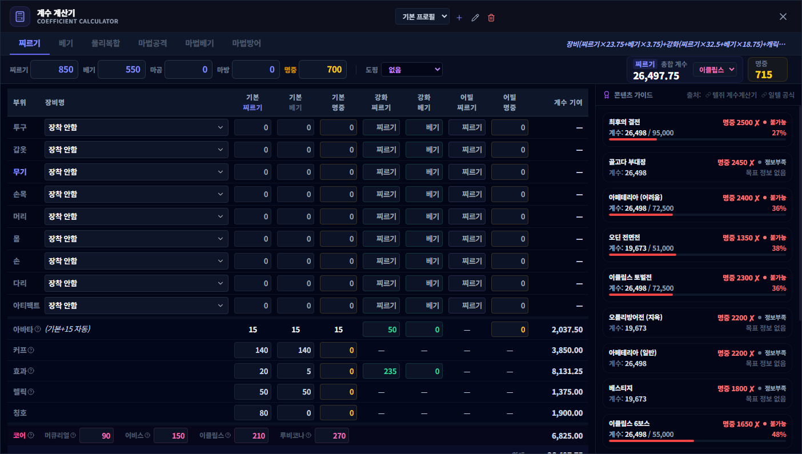

# 대미지 계수 계산기

## 언제 쓰는 기능인가요?

캐릭터 스탯, 장비와 버프를 입력해 공격 계수와 콘텐츠별 명중 기준을 비교할 때 사용합니다.

## 어디에서 켜나요?

사이드바 또는 독 메뉴의 **대미지 계수 계산기**를 엽니다. 장비 사전의 **계수 계산기 입력**에서도 선택한 장비를 전달할 수 있습니다.

## 기본 사용법

1. 찌르기, 베기, 물리복합, 마법 등 공격 계열을 선택합니다.
2. 캐릭터 기본 스탯과 추가 보너스를 입력합니다.
3. 장비 부위별 아이템, 강화 수치와 옵션을 선택합니다.
4. 사용할 버프 프리셋을 적용합니다.
5. 계산된 계수, `캐릭터 / 장비` 순서의 주스탯 합계와 콘텐츠별 명중 기준 표시를 확인합니다.
6. 여러 세팅은 상단의 계산 프리셋으로 나눠 저장합니다.

## 자주 혼동하는 점

- 계산값은 입력한 데이터 기준입니다. 게임 패치나 잘못된 장비·버프 선택은 자동으로 보정되지 않습니다.
- 명중 기준은 콘텐츠 비교용 참고값이며 실제 전투의 모든 조건을 포함하지 않을 수 있습니다.
- 주스탯은 왼쪽에 도핑을 반영한 캐릭터 주스탯, 오른쪽에 선택 코어까지 포함한 장비 주스탯을 표시합니다.
- 시간 측정 기록은 측정 시작 시점의 선택 프로필과 스탯을 함께 저장합니다.
- 계산 프리셋은 현재 PC에 저장됩니다.
- 선택한 사용자 도핑 프리셋은 창을 다시 열어도 유지됩니다. 버프 백과에서 프리셋을 저장하면 열린 계산기의 목록과 계산값도 갱신되며, 선택한 프리셋을 삭제하면 도핑은 **없음**으로 바뀝니다.
- 도핑 상세의 괄호 안 수치는 현재 스탯에 고정 보너스를 더한 뒤 비율 효과로 증가하는 수치입니다.

## 문제 해결

- **장비가 검색되지 않음:** 이름 일부로 다시 검색하거나 장비 사전에서 계산기로 보내세요.
- **계수가 크게 다름:** 공격 계열, 주·부스탯, 코어와 중복 버프를 확인하세요.
- **프로필을 바꿨는데 기록이 다름:** 시간 측정 기록은 현재가 아니라 측정 당시 스탯을 사용합니다.

## 개발 중인 플레이 프로필 연동

플레이 프로필 기능은 앱 시작 시 준비됩니다. 연동 시 상단에 **입력 프로필**이 표시되고 능력치·장비 입력·계산 프리셋과 도핑 선택을 해당 프로필에 저장합니다. 기존에 저장한 입력값은 처음 이전할 때 각 프로필로 복사합니다. 다른 플레이 프로필을 고르면 해당 프로필의 입력을 불러옵니다. 계산 프리셋 이름을 입력 중이면 완료하거나 취소한 뒤 전환하며, 저장에 실패하면 기존 선택과 입력을 유지합니다.

예를 들어 프로필 A와 B에 서로 다른 능력치·장비·강화·코어·도핑을 저장할 수 있으며, 마지막으로 사용한 계산 프리셋도 각자 기억합니다. 스톱워치는 **측정을 시작한 플레이 프로필에서 사용 중인 계산 프리셋과 도핑**을 기록합니다. 측정 도중 계산기 값을 수정하거나 다른 플레이 프로필로 바꿔도 시작 당시 값은 유지됩니다.
