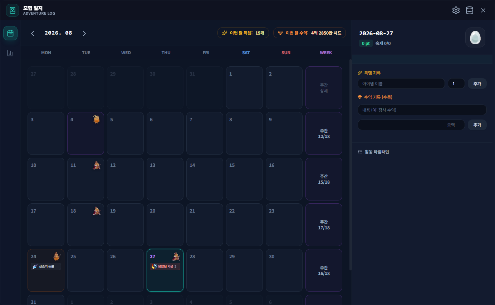
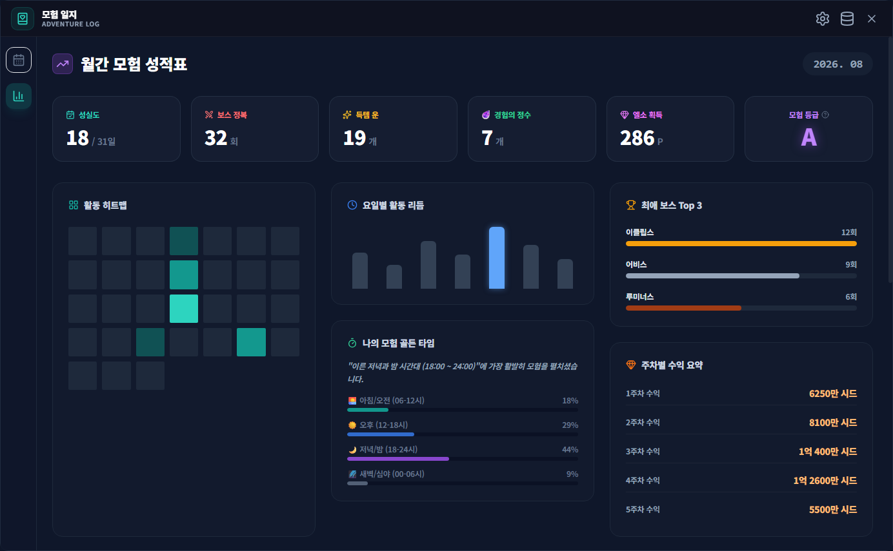

# 모험 일지

## 언제 쓰는 기능인가요?

날짜별 숙제, 득템, 수익과 게임 활동을 모아 보고 월간 통계와 기록을 확인할 때 사용합니다.

## 어디에서 켜나요?

사이드바 또는 독 메뉴의 **모험 일지**를 엽니다.

## 기본 사용법

1. 달력에서 날짜를 선택해 그날의 기록을 봅니다.
2. 자동으로 감지된 득템·숙제·SEED 기록과 직접 추가한 기록을 함께 확인합니다.
3. 필요한 수익이나 메모는 수동으로 추가합니다.
4. 주간·월간 득템 화면의 **품목별 합계**에서 같은 아이템의 총 획득 수량을 먼저 확인합니다.
5. 품목별 합계와 날짜별 기록 사이의 구분선을 위아래로 드래그해 두 영역의 높이를 조절합니다. 조절한 높이는 다음 실행에도 유지됩니다.
6. 통계 화면에서 월간 합계와 활동 분포를 확인합니다.
7. 삭제 버튼이 있는 수동 원본 기록만 개별 삭제할 수 있습니다.

## 자주 혼동하는 점

- 같은 아이템의 여러 기록은 화면에서 합쳐 보일 수 있지만 원본 기록은 로컬 DB에 따로 남습니다.
- **품목별 합계**는 선택한 주간·월간 범위의 아이템을 이름별로 합산한 요약이며, 아래의 날짜별 기록을 삭제하거나 합치는 기능이 아닙니다.
- 자동·과거 기록에는 잘못된 묶음 삭제를 막기 위해 삭제 버튼이 없을 수 있습니다.
- 과거 주차의 주간 숙제는 로그에서 확인된 완료 수를 현재 체크리스트의 주간 숙제 전체 수와 비교해 `완료/전체`로 표시합니다.
- 월간 통계의 **성실도**는 활동 기록이 있는 날짜 수를 선택한 월의 실제 일수와 비교합니다. 2월은 윤년에 따라 28일 또는 29일로 표시됩니다.
- 마정석은 교환 전 보유만으로 수익 처리하지 않습니다. 금화 주머니 환산 또는 사용자가 확정한 계산 결과를 기록합니다.
- 자동 수익 묶음과 펼친 원본 금액은 일간·주간·월간 총수익과 같은 저장 금액을 사용합니다. 금화 주머니 환산액도 각 목록에서 확인할 수 있습니다.
- 일간·주간 타임라인은 숙제와 게임 활동을 실제 시각의 초 단위 순서로 정렬하고, 화면에는 시·분을 표시합니다.
- 모험 일지 DB는 Google Drive 설정·숙제 동기화 대상이 아닙니다.

## 기간별 기록 내보내기

창 오른쪽 위 **기간별 기록 내보내기** 버튼에서 시작일·종료일을 정하고 **기록 확인 → 파일로 저장**을 누릅니다. 최대 366일의 숙제·득템·수익을 브라우저에서 읽는 HTML 파일로 저장합니다. 저장 전에 표시한 건수와 총수익의 스냅샷을 사용하므로 확인 후 들어온 기록도 포함하려면 다시 **기록 확인**을 누르세요.

득템은 현재 일지의 표시 기준을 따르며 수익은 저장된 확정 금액을 사용합니다. 금화 주머니 환산 금액은 이미 수익에 포함되어 있어 다시 더하지 않습니다. 채팅 원문·개인 메모·계정 연동 정보는 포함하지 않으며, 원본 기록은 유지됩니다. 빈 기간도 0건으로 저장할 수 있고 기록이 10만 건을 넘으면 기간을 나누어야 합니다. 이 파일은 읽기용이며 앱 복원에는 기존 ZIP 백업을 사용합니다.

## 프로필별 조회와 수동 기록

프로필 기능 활성화 후에는 상단 **조회 범위**에서 모든 프로필·특정 프로필·미배정 기록을 고릅니다. 처음에는 전체 기록을 표시하며 달력·일간/주간·통계·득템·수익 및 내보내기에 같은 범위를 적용합니다. 삭제된 프로필 이름은 일반 선택지에서 숨기며, 해당 과거 기록은 전체 조회에 보존합니다. 기존에 소유자를 알 수 없는 기록은 미배정으로 남습니다.

날짜를 선택한 뒤 **새 수동 기록을 저장할 프로필**에서 수동 득템·SEED 수익/지출을 저장할 대상을 고릅니다. 조회 범위와는 별개이며, 기본 대상은 현재 사용 중인 프로필입니다. 입력을 시작한 뒤 다른 창에서 프로필을 전환해도 작성 중인 기록의 대상은 바뀌지 않습니다. 현재 조회 범위 밖에 저장했을 때도 대상 이름과 안내를 표시합니다. 저장 실패 시 입력을 유지하며 삭제되거나 이름·서버 설정이 끝나지 않은 프로필에는 저장하지 않습니다.

HTML 내보내기는 조회 범위를 표시하고 확인한 범위의 기록만 저장합니다. 범위를 바꾸면 **기록 확인**을 다시 해야 합니다. 기존 사용자 데이터는 백업 후 프로필 저장소로 이전하며 기존 일지 원본을 보존합니다.

## 문제 해결

- **오늘 기록이 안 보임:** 달력의 선택 날짜와 PC 날짜를 확인하세요.
- **자동 기록이 누락됨:** 게임 채팅 로그와 앱의 로그 경로를 확인하세요.
- **합계가 예상과 다름:** 묶인 항목을 펼쳐 원본 시각과 수량을 확인하세요.
- **다른 PC에 일지가 없음:** 일지는 로컬 데이터이므로 로컬 백업·복원을 사용하세요.

## SEED 수익과 지출

수동 SEED 기록에서 **수익 (+)** 또는 **지출 (-)**을 선택하고 금액은 양의 정수로 입력합니다. 어벤던로드 입장료 지불 로그는 HUD 표시 여부와 관계없이 음수 SEED로 자동 기록됩니다. 마정석 교환 수익과 입장료를 합산한 값이 일간·주간·월간 순수익에 반영됩니다.

## 프로필별 기록

프로필 기능은 기록을 한 일지에 보관하면서 전체·프로필별·미배정으로 나눠 볼 수 있습니다. 기존에 프로필을 알 수 없는 기록은 미배정으로 남기며, 프로필을 바꾸거나 삭제해도 다른 프로필로 옮기지 않습니다. 저장을 기다리던 금화·엘소도 원래 프로필에 반영합니다. 저장·조회 화면과 과거 복원 연결을 전용 검사에서 확인했으며 일반 부팅에도 같은 경계를 적용합니다.

프로필 모드의 과거 로그 복원은 시작할 때 선택한 프로필을 유지합니다. 입장료도 같은 프로필의 음수 SEED로 기록합니다. 이미 다른 프로필/미배정으로 복원한 구간과 직접 작성한 기록은 보존하며 같은 원본을 다른 프로필에 중복 복사하지 않습니다.

## 이전 프로필 기록 정리

삭제되거나 더 이상 존재하지 않는 프로필의 기록이 있으면 상단에 **이전 프로필 정리**가 표시됩니다. 이름·기간·건수를 확인하고 **무시하기 → 미배정으로 옮기기**를 누르면 해당 기록을 미배정 조회에 포함하고 정리 목록에서 제거합니다. 기록 원문은 보존합니다. 현재 사용 중인 프로필로 배정하는 동작은 아닙니다. 프로필 선택창의 숙제 대기 기록 무시와도 별개입니다.

상단 조회 범위가 **미배정 기록**이어도 아래의 새 수동 기록 대상에는 현재 프로필이 보일 수 있습니다. 이 선택은 앞으로 추가할 기록에만 적용하며 기존 미배정 기록의 소유자를 표시하는 부분이 아닙니다.

음수 SEED도 양수와 같은 억·만 단위로 표시합니다. 이전 버전의 입장료 지불 원문과 새 과거 복원 입장료가 같은 날짜·초·금액으로 겹친 경우에는 원본을 보존한 채 한 번만 집계합니다. 서로 다른 현재 프로필·수동 지출·다른 시각의 기록과 정상 반복은 유지합니다.

이전 프로필을 정리한 직후 아직 저장 중인 금화·엘소도 미배정에서 함께 확인할 수 있습니다. 입장료 원문·복원 문구와 저장 금액이 서로 다른 자료는 자동으로 숨기지 않습니다.
