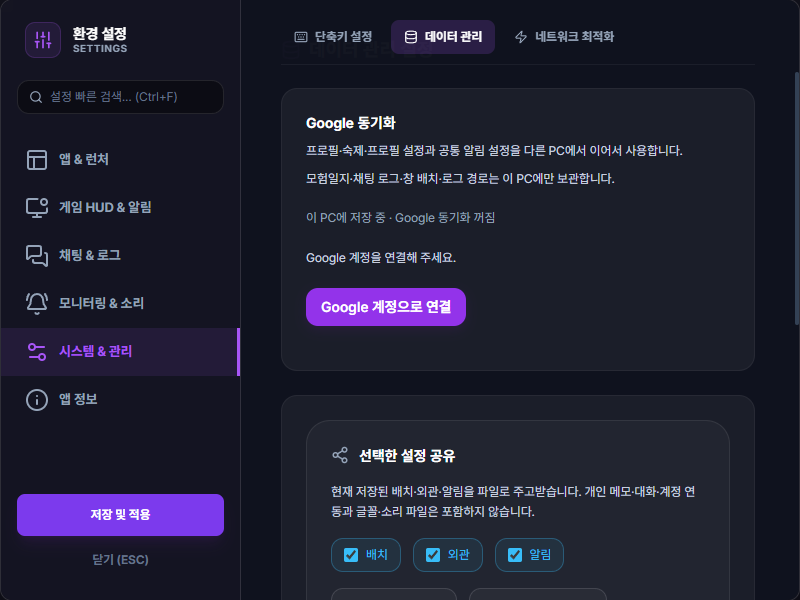
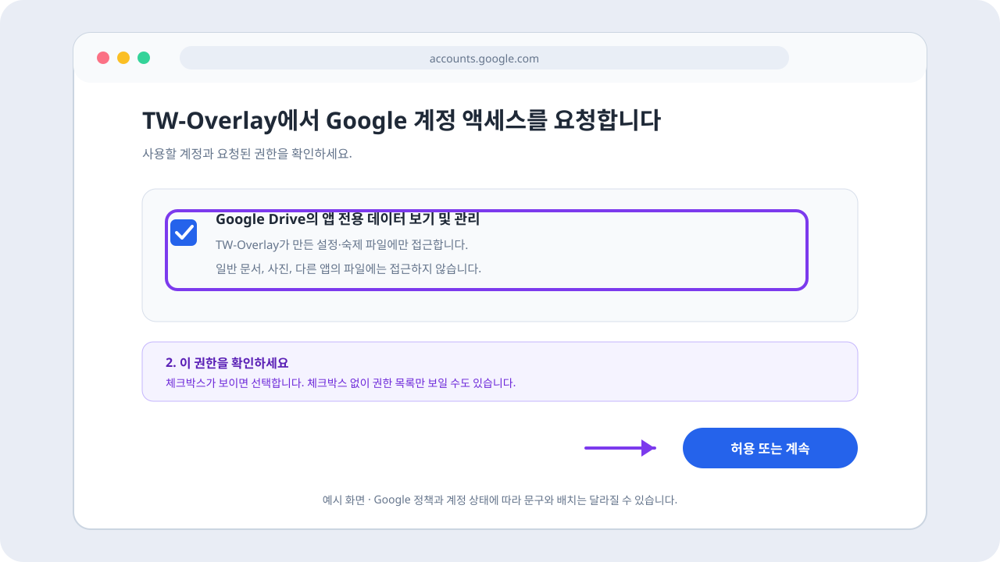

# Google Drive 클라우드 동기화

프로필·숙제·환경설정을 다른 PC에서 이어서 사용합니다. Google 연결 없이도 이 PC의 저장과 플레이는 정상적으로 동작합니다.

## 연결하기

**설정 ⚙️ → 데이터 → Google 동기화**에서 **Google 계정으로 연결**을 누릅니다. 기본 브라우저에서 직접 로그인합니다. 앱에서 Google 비밀번호를 입력받지 않습니다. 진행 중에는 **로그인 취소**로 돌아올 수 있습니다.

권한 안내에 **Google Drive의 앱 전용 데이터 보기 및 관리**가 표시되면 허용합니다. 계정에 따라 체크박스 없이 요청 권한 목록과 허용 버튼만 표시될 수도 있습니다.

이 권한은 TW-Overlay가 만든 숨김 앱 데이터에 사용됩니다. 일반 Drive 문서에는 접근하지 않습니다. [Google의 앱 전용 데이터 설명](https://developers.google.com/workspace/drive/api/guides/appdata)을 참고하세요.

## 처음 연결할 때

브라우저 로그인을 마치고 TW-Overlay로 돌아오면 **Google 로그인 완료 · 동기화 설정이 필요합니다**가 표시됩니다. 이 PC와 Google의 프로필 수, Google 프로필의 이름을 확인하세요. 다른 PC에서도 같은 Google 계정으로 연결합니다.

- **양쪽 병합 (추천)**: 이 PC와 Google의 프로필을 함께 보존합니다. 같은 이름이어도 별도로 만든 프로필은 자동으로 하나로 합치지 않습니다.
- **Google 데이터로 가져오기**: 적용 전 이 PC의 데이터를 ZIP으로 백업한 뒤 프로필·숙제·동기화 대상 설정을 교체합니다. 기존 모험일지는 원래 프로필의 기록으로 남습니다. 이전 Google 계정으로 돌아와 가져올 때 그 계정에 아직 활성 상태인 보관 프로필은 원래 ID로 복원됩니다. 사용자가 삭제한 프로필은 보관 프로필과 별도로 처리합니다. 교체 대상에 반영할 자동 기록이 남아 있으면 프로필 관리에서 해당 기록을 먼저 처리해야 합니다. 병합 중 다른 PC에서 삭제한 프로필에 대기 기록이 있으면 그 삭제를 보류하고 나머지 변경을 계속 반영합니다.
- **나중에 설정**: 이 PC에 계속 저장합니다. Google 로그인은 유지되므로 나중에 같은 메뉴의 **동기화 다시 켜기**를 누르면 브라우저 로그인 없이 이 선택 화면으로 돌아옵니다.

방법을 고른 뒤 **동기화 시작**을 누르면 적용합니다. Google에 가져올 프로필이 없어도 **동기화 시작**을 눌러야 이 PC의 데이터를 전송하기 시작합니다. 설정을 마치기 전에는 자동 확인과 전송을 기다립니다.

처음 설치한 PC의 기본 프로필에 사용자 설정이나 기록이 없으면 가져온 데이터로 채웁니다. 이름을 정하기 전에 저장한 메모나 숙제 설정이 있으면 그 기본 프로필을 보존하고 가져온 프로필을 별도로 추가합니다. 적용 전 백업은 **적용 전 백업 위치**로 찾을 수 있으며 **로컬 백업 불러오기**에서 복원할 수 있습니다. 적용 전 백업은 최근 3개만 보관하며, **적용 전 백업 위치**가 가리키는 백업은 지우지 않습니다.

Google 데이터로 가져오거나 병합에서 빈 기본 프로필을 원격 프로필로 채우기 전에 설정·숙제 화면의 미저장 입력을 확인합니다. 미저장 입력이 있으면 적용을 멈추고 입력을 보존합니다.

**마지막 확인**은 Google Drive의 변경을 마지막으로 확인한 시각이고, **마지막 전송**은 이 PC의 데이터를 Drive에 마지막으로 전송한 시각입니다. 이 PC의 Google 파일을 읽을 수 없어 전송이 보류되면 변경을 이 PC에 보관합니다.

첫 연결 화면은 실제 병합과 같은 규칙으로 Google 프로필 이름과 서버를 표시합니다. 이름·서버를 확정할 수 없거나 읽을 수 없는 Google 파일이 있으면 교체를 선택할 수 없습니다. **양쪽 병합**으로 기존 프로필을 유지한 뒤 **확인할 변경**에서 이름과 서버를 정할 수 있습니다.

자동 동기화를 켜면 앱을 닫을 때 대기 중인 변경의 전송을 시도합니다. 연결이 끊겼다면 이 PC에 변경을 보관하고, 연결이 돌아오면 Google의 재시도 제한에 맞춰 다시 확인합니다.

이전 버전의 동기화 파일은 자동으로 가져오거나 삭제하지 않습니다. 이전 PC를 업데이트한 뒤 새 Google 동기화를 연결해 주세요.

## 동기화되는 내용

| 대상 | 내용 |
|---|---|
| 프로필 | 사용자가 정한 프로필 이름, 선택한 서버, 생성·삭제 정보 |
| 숙제 | 정의·분류·정렬·목표 횟수·리셋 주기, 진행 횟수·완료·해제·참여 제외(N/A) |
| 프로필 설정 | 득템·버프·콘텐츠 알림, 경험치 측정 기준, 고정 메모 내용, 사냥 경험치 계산 입력, 도핑·계수 계산 입력과 프리셋 |
| 공통 설정 | 거래·지정 단어·외치기·갤러리·디스코드 알림의 키워드와 조건 |

전송할 데이터가 너무 많으면 숙제와 일반 설정을 먼저 동기화합니다. 용량이 큰 계산기 프리셋은 이 PC에 보관될 수 있습니다. 환경설정에서 전송 크기와 보류 건수를 확인하고, 프리셋을 줄인 뒤 다시 저장하세요.

현재 선택 프로필, 창 배치·크기·음량·알림음, 로그 경로·단축키·닉네임 메모, Google 토큰·Discord Webhook URL은 이 PC에 유지합니다. 모험일지·채팅 로그·알림 이력·시간 측정 기록·진행 중 HUD도 동기화하지 않습니다. 프로필 선택 전의 미배정 기록은 원래 PC에 보관하며 귀속하기 전에는 전송하지 않습니다.

## 저장 시점과 표시

로컬 저장 완료와 **동기화 완료**는 다릅니다. **이 PC 저장 완료 · 전송 대기**는 안전하게 저장했으며 Google에 아직 전송하지 않았다는 뜻입니다.

다른 Google 계정으로 바꾼 뒤 **양쪽 병합**을 선택하면 현재 이 PC의 동기화 대상 데이터를 새 계정에 처음 전송합니다. 이전 계정의 Drive 파일은 그대로 보관됩니다.

- 직접 바꾼 값은 약 3초 동안 모아서 전송합니다. 계속 수정하더라도 첫 변경부터 최대 10초 안에 전송을 시도합니다.
- 게임 창이 보이면 약 30초, 최소화·숨김·게임 종료 중에는 약 5분마다 새 변경을 확인합니다. 다른 프로그램으로 포커스를 옮긴 것만으로 휴식 상태가 되지는 않습니다.
- 휴식 중 자동 숙제 감지는 약 30초 동안 모으고 최대 60초 안에 전송을 시도합니다. 일반 채팅 수신만으로 추가 전송하지 않습니다.
- 게임 창 복귀·프로필 전환·네트워크 복구 때도 확인합니다. 오류·오프라인·Google 요청 제한 중에는 로컬 변경을 보관하고 재시도 간격을 늘립니다.
- 버프 백과·계수 계산기에서 프리셋 이름을 입력하거나 편집하는 중이면 다른 PC의 변경 반영만 잠시 미룹니다. 이 PC의 변경은 계속 전송하고, 편집을 저장하거나 취소하면 다시 반영합니다. 오류가 아니므로 재시도 간격을 늘리지 않습니다.

`지금 동기화`는 새 변경 확인·병합·전송을 요청합니다. **자동 동기화**를 끈 경우에도 직접 실행할 수 있습니다. 최초 설정 중이거나 `나중에 설정`을 선택한 상태에서도 `연결 해제`를 누를 수 있습니다. 이 PC의 인증을 지우며 로컬 데이터와 Drive의 기존 파일은 보존합니다.

## 여러 PC를 함께 사용할 때

서로 다른 프로필의 변경은 모두 유지합니다. 현재 선택은 PC마다 독립적이며 다른 PC가 사용 중인 프로필로 자동 전환하지 않습니다.

계산기 프리셋이 전송 용량을 넘으면 새 입력을 이 PC에 보관하고 전송을 보류합니다. 다른 PC에는 마지막으로 전송한 프리셋이 남습니다. 직접 지운 프리셋은 삭제가 동기화됩니다.

같은 프로필의 서로 다른 설정은 함께 반영합니다. 같은 숙제의 완료·해제·횟수 변경은 합산하거나 무조건 큰 값으로 덮지 않습니다. 변경의 선후 관계와 인터넷 기준 시각을 비교하고, 순서를 확정할 수 없으면 **확인할 변경**에 양쪽 값을 보관합니다. 같은 값은 다시 묻지 않습니다.

일일·주간 숙제는 한국 시각 기준으로 초기화됩니다. 지난 주기의 충돌은 표시하지 않으며, 각 PC에서 자동으로 0회가 되어도 새 주기 진행은 유지됩니다. 직접 완료를 취소하거나 횟수를 0으로 바꾼 경우에는 그 변경도 동기화합니다. 초기화 규칙을 바꿀 때는 원래 주기와 변경된 주기 모두에서 유효한 동안 기존 진행을 유지합니다.

확인할 변경에서 값을 선택하면 해당 항목에 적용 중 안내가 표시됩니다. 적용한 결과는 다른 PC에도 전달됩니다. 미해결 항목은 현재 값을 유지하고 다른 정상 항목은 계속 동기화합니다. 강제 팝업으로 게임을 가리지 않습니다.

사용 중인 프로필의 이름·서버·삭제는 확인 전 반영하지 않습니다. 다른 값을 수락하면 프로필을 다시 선택할 때까지 자동 기록을 대기시킵니다. **이 PC 값 유지**처럼 값이 바뀌지 않으면 선택을 그대로 유지합니다.

v3.2.2는 고정 메모와 발굴지 안내를 PC마다 따로 보관했습니다. 두 PC를 업그레이드해 연결하면 같은 캐릭터의 이전 값이 달라도 캐릭터마다 확인하지 않습니다. 메모는 두 PC의 내용을 `---` 구분선으로 이어 모두 남기고(같은 내용은 하나), 발굴지 안내는 한쪽이라도 켰으면 켭니다. 이어 붙인 메모가 1000자를 넘으면 **확인할 변경**에서 고릅니다. 업그레이드 뒤 직접 고친 값은 위의 일반 규칙을 따릅니다. 시간 측정 중인 프로필은 다른 프로필을 사용하고 있어도 삭제에서 보호합니다.

## 문제 해결

- **다시 로그인 필요**: Google 인증이 만료된 상태입니다. 다시 연결하면 보관한 변경부터 이어서 처리합니다.
- **전송 대기가 계속됨**: 인터넷 연결, Google 저장공간과 요청 제한을 확인하세요. 실패했다고 로컬 데이터를 지우거나 초기화할 필요는 없습니다.
- **읽을 수 없는 Google 파일**은 해당 파일의 마지막 정상 기록을 유지합니다. 읽을 수 있는 다른 파일은 계속 동기화합니다. 이 PC의 파일에 문제가 생겼다면 새 변경은 전송 대기에 두고, **지금 동기화**를 누르면 보류된 파일도 다시 확인합니다.
- **백업 복원 후 데이터 선택이 다시 나옴**: 오래된 백업으로 최신 원격 파일을 덮지 않도록 비교하는 과정입니다. 적용 전 백업을 남기고 병합 또는 가져오기를 선택하세요.
- **전체 로컬 백업을 복원함**: 같은 PC에서도 전송 대기를 새로 구성합니다. 다음 연결에서 Google 데이터를 확인하고 동기화 방법을 다시 선택합니다. 복원 이전 전송 파일은 보존됩니다.
- **Drive에서 파일이 보이지 않음**: 앱 전용 숨김 공간에 저장하므로 정상입니다. 완전히 삭제하려면 Drive 웹의 **설정 → 앱 관리 → TW-Overlay → 숨겨진 앱 데이터 삭제**를 사용하세요.
- **Google 권한을 철회하려면**: [Google 계정 연결 관리](https://myaccount.google.com/connections)에서 TW-Overlay 접근 권한을 삭제할 수 있습니다.
