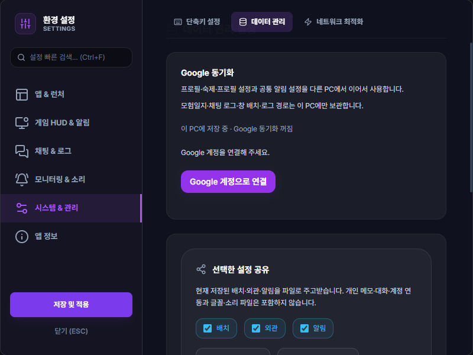
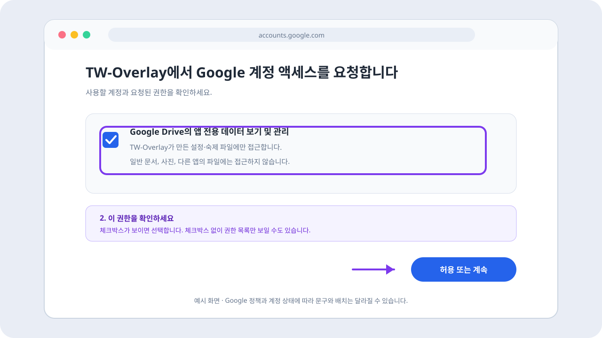

# Google Drive 클라우드 동기화

프로필·숙제·환경설정을 다른 PC에서 이어서 사용합니다. Google 연결 없이도 이 PC의 저장과 플레이는 정상적으로 동작합니다.

## 연결하기

**설정 ⚙️ → 시스템 & 관리 → 데이터 관리**에서 **Google 계정으로 연결**을 누릅니다. 기본 브라우저에서 직접 로그인합니다. 앱에서 Google 비밀번호를 입력받지 않습니다. 진행 중에는 **로그인 취소**로 돌아올 수 있습니다.

권한 안내에 **Google Drive의 앱 전용 데이터 보기 및 관리**가 표시되면 허용합니다. 계정에 따라 체크박스 없이 요청 권한 목록과 허용 버튼만 표시될 수도 있습니다.

이 권한은 TW-Overlay가 만든 숨김 앱 데이터에 사용됩니다. 일반 Drive 문서에는 접근하지 않습니다. [Google의 앱 전용 데이터 설명](https://developers.google.com/workspace/drive/api/guides/appdata)을 참고하세요.

## 처음 연결할 때

Google에 새 방식의 데이터가 있으면 바로 덮어쓰지 않고 선택을 받습니다. 다른 PC에서도 같은 Google 계정으로 연결하세요.

- **양쪽 병합 (추천)**: 이 PC와 Google의 프로필을 함께 보존합니다. 같은 이름이어도 별도로 만든 프로필은 자동으로 하나로 합치지 않습니다.
- **Google 데이터로 가져오기**: 적용 전 이 PC의 데이터를 ZIP으로 백업한 뒤 프로필·숙제·동기화 대상 설정을 교체합니다. 기존 모험일지는 원래 프로필의 기록으로 남습니다.
- **이 PC 유지 · 동기화 끄기**: 이 PC의 내용을 유지하며 원격 데이터에 쓰지 않습니다.

처음 설치한 PC의 빈 기본 프로필은 가져온 데이터로 채웁니다. 원격 프로필이 두 개라면 불필요한 빈 기본 프로필을 더해 세 개를 만들지 않습니다. 적용 전 백업은 **적용 전 백업 위치**로 찾을 수 있으며 **로컬 백업 불러오기**에서 복원할 수 있습니다.

Google 데이터로 가져오기 전에 설정·숙제 화면에서 편집 중인 내용을 먼저 저장해 주세요. 미저장 입력이 있으면 적용을 멈추고 입력을 보존합니다.

이전 버전의 동기화 파일은 자동으로 가져오거나 삭제하지 않습니다. 이전 PC를 업데이트한 뒤 새 Google 동기화를 연결해 주세요.

## 동기화되는 내용

| 대상 | 내용 |
|---|---|
| 프로필 | 사용자가 정한 프로필 이름, 선택한 서버, 생성·삭제 정보 |
| 숙제 | 정의·분류·정렬·목표 횟수·리셋 주기, 진행 횟수·완료·해제·참여 제외(N/A) |
| 프로필 설정 | 득템·버프·콘텐츠 알림, 경험치 측정 기준, 고정 메모 내용, 사냥 경험치 계산 입력, 도핑·계수 계산 입력과 프리셋 |
| 공통 설정 | 거래·지정 단어·외치기·갤러리·디스코드 알림의 키워드와 조건 |

현재 선택 프로필, 창 배치·크기·음량·알림음, 로그 경로·단축키·닉네임 메모, Google 토큰·Discord Webhook URL은 이 PC에 유지합니다. 모험일지·채팅 로그·알림 이력·시간 측정 기록·진행 중 HUD도 동기화하지 않습니다. 프로필 선택 전의 미배정 기록은 원래 PC에 보관하며 귀속하기 전에는 전송하지 않습니다.

## 저장 시점과 표시

로컬 저장 완료와 **동기화 완료**는 다릅니다. **이 PC 저장 완료 · 전송 대기**는 안전하게 저장했으며 Google에 아직 전송하지 않았다는 뜻입니다.

- 직접 바꾼 값은 약 3초 동안 모아서 전송합니다. 계속 수정하더라도 첫 변경부터 최대 10초 안에 전송을 시도합니다.
- 게임 창이 보이면 약 30초, 최소화·숨김·게임 종료 중에는 약 5분마다 새 변경을 확인합니다. 다른 프로그램으로 포커스를 옮긴 것만으로 휴식 상태가 되지는 않습니다.
- 휴식 중 자동 숙제 감지는 약 30초 동안 모으고 최대 60초 안에 전송을 시도합니다. 일반 채팅 수신만으로 추가 전송하지 않습니다.
- 게임 창 복귀·프로필 전환·네트워크 복구 때도 확인합니다. 오류·오프라인·Google 요청 제한 중에는 로컬 변경을 보관하고 재시도 간격을 늘립니다.

`지금 동기화`는 새 변경 확인·병합·전송을 요청합니다. **자동 동기화**를 끈 경우에도 직접 실행할 수 있습니다. `연결 해제`는 이 PC의 인증을 지우며 로컬 데이터와 Drive의 기존 파일은 보존합니다.

## 두 PC를 함께 사용할 때

서로 다른 프로필의 변경은 모두 유지합니다. 현재 선택은 PC마다 독립적이며 다른 PC가 사용 중인 프로필로 자동 전환하지 않습니다.

같은 프로필의 서로 다른 설정은 함께 반영합니다. 같은 숙제의 완료·해제·횟수 변경은 합산하거나 무조건 큰 값으로 덮지 않습니다. 변경의 선후 관계와 인터넷 기준 시각을 비교하고, 순서를 확정할 수 없으면 **확인할 변경**에 양쪽 값을 보관합니다. 같은 값은 다시 묻지 않습니다.

확인할 변경에서 값을 선택하면 다른 PC에도 같은 해결 결과를 전달합니다. 미해결 항목은 현재 값을 유지하고 다른 정상 항목은 계속 동기화합니다. 강제 팝업으로 게임을 가리지 않습니다.

사용 중인 프로필의 이름·서버·삭제는 확인 전 반영하지 않습니다. 수락하면 필요한 경우 프로필을 다시 선택할 때까지 자동 기록을 대기시킵니다. 시간 측정 중인 프로필은 다른 프로필을 사용하고 있어도 삭제에서 보호합니다.

## 문제 해결

- **다시 로그인 필요**: Google 인증이 만료된 상태입니다. 다시 연결하면 보관한 변경부터 이어서 처리합니다.
- **전송 대기가 계속됨**: 인터넷 연결, Google 저장공간과 요청 제한을 확인하세요. 실패했다고 로컬 데이터를 지우거나 초기화할 필요는 없습니다.
- **백업 복원 후 데이터 선택이 다시 나옴**: 오래된 백업으로 최신 원격 파일을 덮지 않도록 비교하는 과정입니다. 적용 전 백업을 남기고 병합 또는 가져오기를 선택하세요.
- **다른 PC의 백업을 복원함**: 같은 프로필과 기록을 유지하되 전송 대기는 현재 PC에서 다시 구성합니다. 원래 PC의 전송 파일을 덮어쓰지 않습니다.
- **Drive에서 파일이 보이지 않음**: 앱 전용 숨김 공간에 저장하므로 정상입니다. 완전히 삭제하려면 Drive 웹의 **설정 → 앱 관리 → TW-Overlay → 숨겨진 앱 데이터 삭제**를 사용하세요.
- **Google 권한을 철회하려면**: [Google 계정 연결 관리](https://myaccount.google.com/connections)에서 TW-Overlay 접근 권한을 삭제할 수 있습니다.
