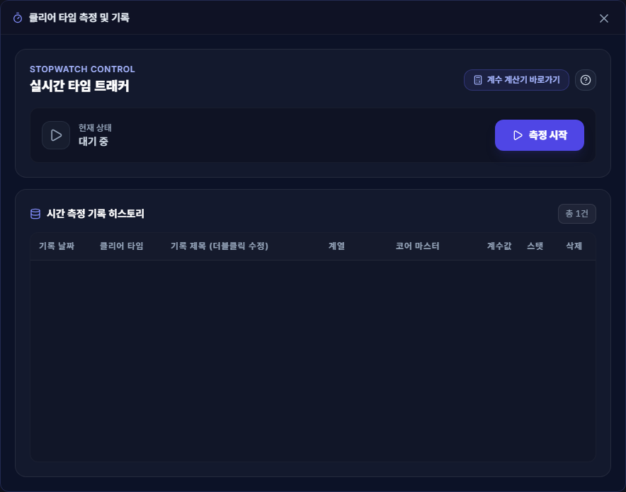

# 시간 측정 및 기록

## 언제 쓰는 기능인가요?

보스나 던전의 클리어 시간을 재고, 당시 캐릭터 계수 설정과 함께 기록을 비교할 때 사용합니다.

## 어디에서 켜나요?

사이드바 또는 독 메뉴의 **시간 측정 및 기록**을 엽니다. 게임 중에는 기본 단축키 `Ctrl + Shift + S`로 측정을 시작하거나 끝낼 수 있습니다.

## 기본 사용법

1. **측정 시작**을 누르거나 단축키를 입력합니다.
2. 콘텐츠가 끝나면 **측정 종료**를 누르거나 단축키를 다시 입력합니다.
3. 저장된 행의 제목을 더블클릭해 알아보기 쉬운 이름으로 바꿉니다.
   Enter 또는 다른 곳을 클릭하면 저장하고, Escape를 누르면 제목 편집을 취소합니다.
4. 필요하면 계열과 코어 마스터를 바꿔 당시 스탯 기준 계수를 다시 계산합니다.
5. 현재 설정을 점검하려면 **계수 계산기 바로가기**를 사용합니다.

## 자주 혼동하는 점

- 측정을 끝내야 기록이 저장됩니다.
- 관리 창을 닫아도 측정은 계속됩니다. 창을 다시 열어 **측정 종료**를 누르거나 단축키로 종료하면 기록이 저장됩니다. 앱 자체를 종료하면 진행 중인 측정은 보관되지 않습니다.
- 측정 시작 시점의 계수 계산기 프로필을 함께 기록하므로, 나중에 현재 프로필이 바뀌어도 당시 기록을 비교할 수 있습니다.
- 새 기록은 시작 때 선택한 도핑 효과도 함께 보관합니다. 과거 기록에는 해당 정보가 없어 기존 방식으로 도핑 프리셋을 참조합니다.
- 기록은 현재 PC의 로컬 DB에 저장되며 Google Drive 설정·숙제 동기화 대상이 아닙니다.

## 개발 중인 프로필 연결

아래 동작은 프로필 통합 개발 내용이며 앱 시작 시 프로필을 준비한 뒤 사용합니다.

- 측정할 프로필을 먼저 선택합니다. 관리 창과 HUD에 현재 측정 프로필을 표시합니다.
- 프로필마다 별도로 시간을 잽니다. 다른 프로필로 전환해도 원래 측정은 계속되며, 원래 프로필로 돌아와 종료하면 기록됩니다. 측정 중인 프로필을 삭제하려면 먼저 측정을 마쳐야 합니다.
- 시작할 때 해당 프로필에 저장된 계수 계산기 값과 도핑 효과를 고정합니다. 기록을 다시 계산할 때도 다른 프로필의 버프를 사용하지 않습니다. 과거 기록에서 사용자 도핑 정보를 다시 읽어야 하는데 원래 프로필도 삭제됐다면 재계산을 안내와 함께 중단합니다.
- 기록 보기는 현재 프로필을 기본으로 전체·지정 프로필·미배정 기록을 선택할 수 있습니다. 삭제한 프로필의 기록도 남습니다. 조회 범위를 바꿔도 측정할 프로필은 바뀌지 않습니다.
- 제목을 편집하는 동안 기록이 갱신되거나 프로필을 전환해도 입력을 유지합니다. 전환하면 편집하던 프로필의 목록에 머뭅니다. 저장 실패 시 입력을 유지하므로 Enter로 다시 저장하거나 Escape로 취소할 수 있습니다.
- 앱 자체를 종료하면 진행 중인 측정은 보관되지 않습니다. 저장한 기록은 현재 PC에만 유지합니다.

## 문제 해결

- **단축키가 반응하지 않음:** 설정의 단축키가 변경됐는지, 다른 프로그램이 같은 키를 사용 중인지 확인하세요.
- **계수값이 기대와 다름:** 측정 전에 계수 계산기의 사용할 프로필과 스탯을 확인하세요.
- **기록 제목이 비어 있음:** 정상 동작입니다. 제목 칸을 더블클릭해 직접 입력하세요.
